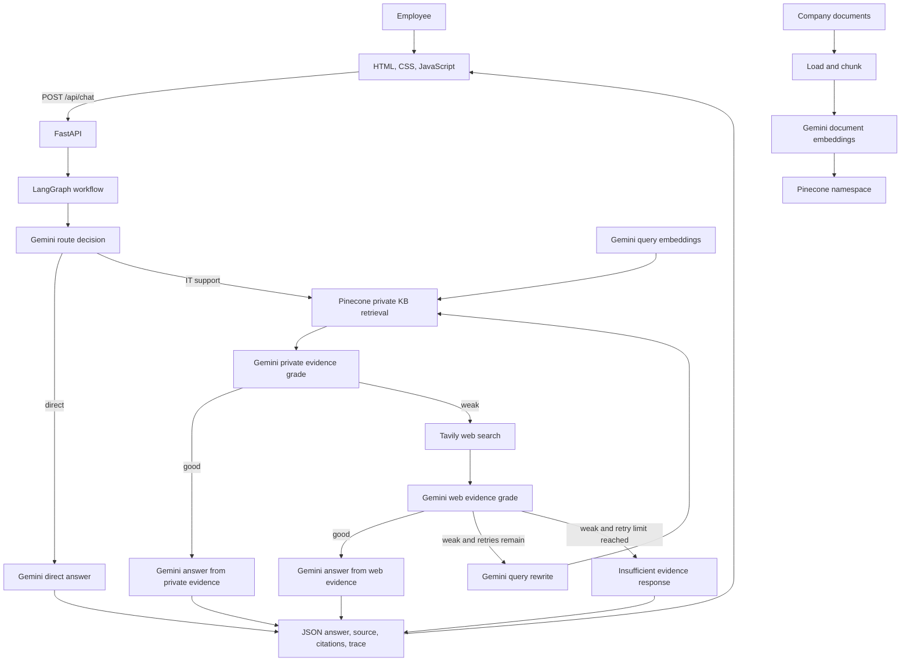

# Agentic RAG IT Support Copilot

An internal IT support assistant that searches trusted company documents first, evaluates whether the retrieved evidence is sufficient, and uses external web search only when private evidence is weak. The application combines a LangGraph workflow, FastAPI backend, Pinecone vector store, Gemini chat and embedding models, Tavily search, and a browser interface.

## Business context

The example customer is NovaRetail, a fictional 3,000-employee retailer. Its IT team maintains policies and runbooks for VPN access, passwords, MFA, approved software, lost devices, email, laptop troubleshooting, and ticket priority. Employees may create repetitive support requests when they cannot find the correct internal guidance. Keyword search can return many irrelevant documents, while a general chatbot may provide unsupported answers. Some requests also depend on current vendor information that is not present in the internal knowledge base.

The goal is to provide a support copilot that:

- Prefers trusted internal knowledge over public web results.
- Grades evidence before generating an answer.
- Uses web search as a fallback when private evidence is weak.
- Rewrites and retries weak searches within a configured limit.
- Identifies the selected answer source and exposes workflow trace events.
- Lets authorized staff add supported company documents without changing Python code.

## Why this is an FDE project

A Forward Deployed Engineer connects a customer's operational problem to an integrated product, not only a model notebook. This repository demonstrates the path from a sample customer problem through knowledge ingestion, agent workflow, API, user interface, configuration, and basic audit logging. It is a local demonstration project: the repository does not include a Docker deployment, a production rollout, or populated automated tests.

## Features

- Routes support questions to private knowledge retrieval and greetings/simple chat to a direct answer.
- Retrieves relevant document chunks from Pinecone and grades their evidence before answering.
- Falls back to Tavily web search when the private KB grade is weak.
- Grades web evidence, rewrites the query, retries, or returns an insufficient-evidence response.
- Returns the answer, source label, citations, workflow trace, and rewritten query.
- Ingests PDF, TXT, Markdown, and DOCX files.
- Logs successful chat questions, selected sources, and traces in SQLite.
- Provides a responsive browser UI with a persisted light/dark theme preference.

## Architecture



`app/main.py` mounts the static assets, serves `templates/index.html`, includes the API router, and initializes the SQLite audit table. `app/rag/workflow.py` defines the LangGraph state machine. `app/services/ingestion.py` loads and chunks documents, while `app/rag/vectorstore.py` manages Gemini embeddings and Pinecone retrieval/indexing.

### LangGraph workflow

1. `route_question` uses Gemini structured output to choose `kb` or `direct`.
2. A direct route calls `direct_answer` and ends without vector or web retrieval.
3. An IT/support route searches the configured Pinecone namespace for the top `TOP_K` chunks.
4. `grade_kb` asks Gemini whether the private evidence is sufficient and specific. A good grade goes to `generate_from_kb` and ends.
5. A weak KB grade invokes Tavily. Gemini grades the returned web evidence; a good grade goes to `generate_from_web` and ends.
6. If web evidence is weak and retries remain, `rewrite_query` asks Gemini for a better search query and returns to private retrieval. If the KB remains weak, the graph can search the web again.
7. Once the retry limit is reached with weak web evidence, `insufficient` returns a response asking the user to contact the help desk or provide more details.

The initial request is not counted as a retry. `MAX_RETRIES` is checked in the web evidence grading branch. Each executed node appends a decision to the trace.

### How the AI and search services work together

- **Gemini chat model:** `ChatGoogleGenerativeAI` handles routing, evidence grading, query rewrites, and answer generation. The configured default is `gemini-3.5-flash-lite` with temperature `0`. Route and evidence decisions use structured output.
- **Gemini embeddings:** `GoogleGenerativeAIEmbeddings` creates vectors for documents and query retrieval. The default model is `gemini-embedding-001`; the vectorstore code requests 1536 output dimensions.
- **Pinecone:** `PineconeVectorStore` stores and retrieves chunks in `PINECONE_NAMESPACE`. Retrieval uses cosine similarity and `TOP_K` results. If the index does not exist, the code creates a serverless AWS index in `us-east-1` with the configured dimension.
- **Tavily:** `TavilySearch` is called only after a weak private-KB grade. It requests up to five general results and an answer summary, without raw content. Gemini then grades the web evidence before any web-grounded answer is generated.

**Important Pinecone caution:** If the configured index already exists but has a different dimension, `ensure_index()` deletes and recreates it. This permanently removes vectors in that index. Verify the index name and dimension before running the app or ingestion script, especially when reusing a shared or production index.

## Technology stack

| Layer | Technology | Purpose |
| --- | --- | --- |
| Agent workflow | LangGraph | Stateful routing and conditional decisions |
| Chat model | Google Gemini through LangChain Google GenAI | Routing, evidence grades, rewrites, answer generation |
| Embeddings | Gemini embeddings | Vectorize documents and user queries |
| Vector database | Pinecone | Store and retrieve private knowledge chunks |
| External search | Tavily | Fallback search when private evidence is weak |
| API | FastAPI and Uvicorn | Web application and JSON/multipart endpoints |
| Document processing | LangChain loaders and text splitters, pypdf, python-docx | Load and chunk supported files |
| Audit storage | SQLite | Store question, source, and trace for successful chat requests |
| Web interface | HTML, CSS, JavaScript, Jinja2 | Employee chat interface and theme toggle |

The dependency list is `requirements.txt`. It currently includes Groq-related dependencies, but the application workflow imports and uses Gemini rather than Groq. `HUGGINGFACE_API_KEY` also exists in settings but is not consumed by the current code. There is no Dockerfile in the current repository.

## Project structure

```text
.
|-- .env                         # Local secrets/configuration; ignored by git
|-- .gitignore
|-- .vscode/
|   `-- settings.json
|-- LICENSE
|-- README.md
|-- requirements.txt
|-- run.py
|-- create_project.py
|-- ingest_sample_kb.py
|-- app/
|   |-- main.py
|   |-- api/
|   |   |-- __init__.py
|   |   `-- routes.py
|   |-- core/
|   |   |-- __init__.py
|   |   |-- config.py
|   |   `-- logging.py
|   |-- rag/
|   |   |-- __init__.py
|   |   |-- state.py
|   |   |-- vectorstore.py
|   |   `-- workflow.py
|   `-- services/
|       |-- __init__.py
|       |-- audit.py
|       `-- ingestion.py
|-- data/
|   |-- audit.db                  # SQLite audit database
|   `-- sample_kb/
|       |-- company_it_handbook.md
|       `-- service_desk_runbook.md
|-- static/
|   |-- css/
|   |   `-- style.css
|   `-- js/
|       `-- app.js
|-- templates/
|   `-- index.html
|-- tests/                        # Currently empty
`-- uploads/                      # Upload destination; currently empty
```

Generated `__pycache__` directories are omitted. There is no `.env.example` file in the repository; a safe template is included below. `create_project.py` creates folders and placeholder files and is not needed to run the existing application.

## Prerequisites

- Python 3.10 or newer.
- A Gemini API key for chat and embeddings.
- A Pinecone API key and permission to create/use the configured index.
- A Tavily API key if the workflow needs its web fallback.
- Network access to the configured provider APIs.

Direct greetings still use Gemini. IT/support questions require Gemini and Pinecone; weak private evidence additionally requires Tavily.

## Installation and configuration

From the project root, create and activate a virtual environment and install the dependencies:

```powershell
py -m venv .venv
.\.venv\Scripts\Activate.ps1
python -m pip install --upgrade pip
python -m pip install -r requirements.txt
```

Create `.env` in the project root. `.env` is ignored by git. Never commit real credentials. The repository does not include `.env.example`; this safe placeholder template shows the settings read by `app/core/config.py`:

```dotenv
# Required provider credentials
GEMINI_API_KEY=replace-with-your-gemini-api-key
PINECONE_API_KEY=replace-with-your-pinecone-api-key
TAVILY_API_KEY=replace-with-your-tavily-api-key

# App and model settings (defaults shown)
APP_NAME=Enterprise IT Support Agentic RAG Copilot
APP_ENV=development
GEMINI_MODEL=gemini-3.5-flash-lite
EMBEDDING_MODEL=gemini-embedding-001
PINECONE_INDEX_NAME=agentic-rag
PINECONE_NAMESPACE=company-it-kb
TOP_K=4
MAX_RETRIES=6

# Change this before using document uploads
ADMIN_API_KEY=replace-with-a-long-random-value

# Optional path overrides; defaults are relative to the project root
# AUDIT_DB_PATH=data/audit.db
# UPLOAD_DIR=uploads
# SAMPLE_KB_DIR=data/sample_kb

# Defined in settings but unused by the current application
# HUGGINGFACE_API_KEY=
```

`ADMIN_API_KEY` defaults to the insecure value `change-me`; set a private value before using `/api/ingest`. Other defaults and optional fields are defined in `app/core/config.py`. Restart the application after changing `.env` values.

## Run the application

With the virtual environment active and `.env` configured:

```powershell
python run.py
```

`run.py` starts Uvicorn on `127.0.0.1:8000` with reload enabled. Open <http://127.0.0.1:8000/> for the web interface. FastAPI's interactive API docs are at <http://127.0.0.1:8000/docs>.

### API endpoints

| Method and path | Behavior |
| --- | --- |
| `GET /api/health` | Returns `status: ok` and the configured service name. |
| `POST /api/chat` | Accepts a JSON question and returns `answer`, `source_used`, `trace`, `citations`, and `rewritten_query`. Question length must be 2–3000 characters. |
| `POST /api/ingest` | Accepts a multipart `file` upload and requires the `X-Admin-Key` header to match `ADMIN_API_KEY`. |

Example health request:

```powershell
Invoke-RestMethod http://127.0.0.1:8000/api/health
```

Example chat request:

```powershell
$body = @{ question = "How do I connect to the company VPN?" } | ConvertTo-Json
Invoke-RestMethod -Uri http://127.0.0.1:8000/api/chat -Method Post -ContentType 'application/json' -Body $body
```

Example document upload (replace the key with your local admin key):

```powershell
curl.exe -X POST http://127.0.0.1:8000/api/ingest `
	-H "X-Admin-Key: YOUR_LOCAL_ADMIN_KEY" `
	-F "file=@data/sample_kb/company_it_handbook.md"
```

## Ingest sample knowledge-base documents

Set Gemini and Pinecone credentials and verify the configured Pinecone index and dimension before running:

```powershell
python ingest_sample_kb.py
```

The script reads files immediately inside `SAMPLE_KB_DIR` (default `data/sample_kb/`), loads them, chunks them, embeds them, and adds them to the configured Pinecone namespace. It prints the file, chunk, and vector counts. It does not recursively scan subdirectories.

Supported extensions are `.pdf`, `.txt`, `.md`, and `.docx`. Text and Markdown files are read as UTF-8. The splitter uses `chunk_size=900`, `chunk_overlap=120`, and `add_start_index=True`. DOCX extraction reads non-empty paragraphs. The upload endpoint first saves the uploaded file under `UPLOAD_DIR` (default `uploads/`).

## Demo scenarios

These are expected outcomes based on the sample documents and grading prompts; the model determines the actual route and evidence grade at runtime.

| Ask | Expected path | Demonstrates |
| --- | --- | --- |
| “How do I connect to the company VPN from home?” | Private KB retrieval, good evidence, answer from the company handbook. | Trusted internal guidance is preferred without web search. |
| “Can IT support ask me to share my MFA code?” | Private KB retrieval and answer from the MFA policy when evidence is graded sufficient. | Company-specific policy grounding. |
| “What is the latest Microsoft Teams outage guidance?” | The sample KB does not cover this; weak private evidence should lead to Tavily search. | External fallback for current information. |
| “My work communication app is acting strange after the new update. What should I do?” | If initial evidence is weak, the workflow may rewrite the query and retry, bounded by `MAX_RETRIES`. | Query rewriting for vague or difficult retrieval. |
| “Hello!” | Direct route and answer without vector retrieval. | Simple conversation does not need document search. |

For an upload demo, select **Add company document**, enter `ADMIN_API_KEY`, and choose a supported file. The server validates the extension, saves and loads the document, splits it into chunks, creates embeddings, and writes vectors to the configured Pinecone namespace. The response reports the filename and chunk count.

## Audit data

At startup the application initializes the SQLite `query_audit` table. Successful chat requests record a UTC timestamp, question, selected source, and workflow trace; answer text is not stored by the current implementation. The database defaults to `data/audit.db` and can be changed with `AUDIT_DB_PATH`.

## Troubleshooting

- **Missing API key errors:** Check variable names and values in the project-root `.env`, then restart the application.
- **`ModuleNotFoundError` for a LangChain integration:** Activate the intended virtual environment and run `python -m pip install -r requirements.txt` there. Make sure the selected Python interpreter is the same one used to start `python run.py`.
- **Pinecone index dimension error:** The default Gemini embedding setup requests 1536 dimensions. Verify the existing index dimension and configured index name. A mismatch causes the current code to delete and recreate that index, removing its vectors.
- **`TAVILY_API_KEY is missing`:** Configure Tavily if a request needs web fallback. A private-KB answer can still succeed when its evidence is graded good.
- **No useful retrieved chunks:** Run `python ingest_sample_kb.py`; confirm it reports files, chunks, and vector IDs. Check that the script and server use the same index and namespace.
- **Upload returns 401:** The `X-Admin-Key` request header must equal `ADMIN_API_KEY` from the server environment. Do not use the default `change-me` outside local development.
- **Upload rejects a file:** Only PDF, TXT, Markdown (`.md`), and DOCX extensions are supported.
- **SQLite cannot open the audit database:** Confirm the configured `AUDIT_DB_PATH` parent directory exists and is writable.
